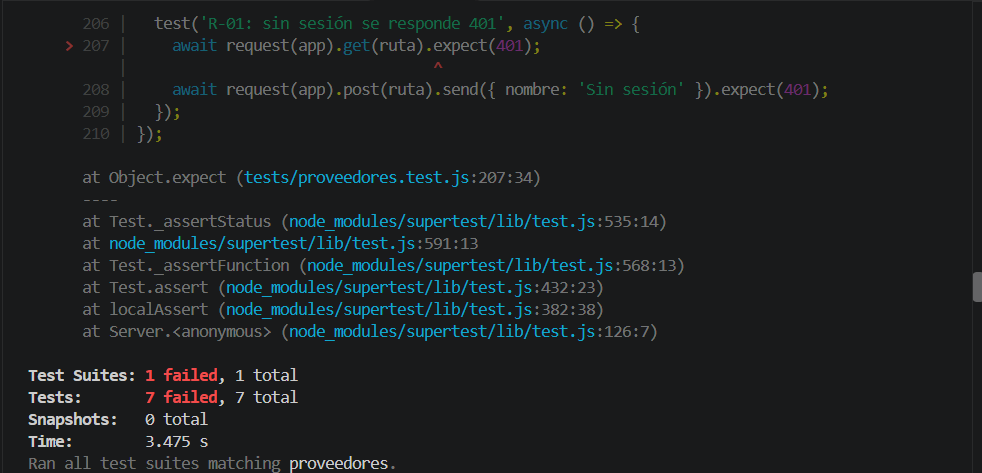
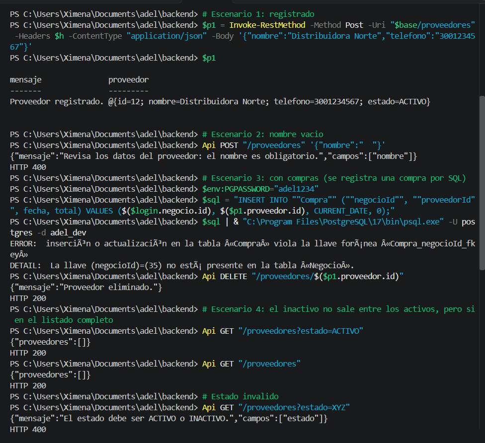

# Proveedores (/api/proveedores)

**Sprint 2 · HU-09 · T27 y T28**

## 1. Contrato

Todas las rutas exigen sesión (`Authorization: Bearer <token>`). El negocio se toma de la sesión y no del cuerpo de la solicitud (R-01).

| Caso | Solicitud | Código | Respuesta |
| --- | --- | --- | --- |
| Registrar | `POST /api/proveedores` con `nombre` y `telefono` (opcional) | `201` | `{ mensaje, proveedor: { id, nombre, telefono, estado } }`; el estado inicial es `ACTIVO` |
| Nombre vacío o ausente | `POST /api/proveedores` | `400` | `{ mensaje, campos: ["nombre"] }` |
| Listar | `GET /api/proveedores` | `200` | `{ proveedores: [...] }` ordenados por nombre |
| Listar solo activos | `GET /api/proveedores?estado=ACTIVO` | `200` | Solo los proveedores activos |
| Estado inválido | `GET /api/proveedores?estado=XYZ` | `400` | `{ mensaje, campos: ["estado"] }` |
| Eliminar con compras | `DELETE /api/proveedores/:id` | `200` | El proveedor pasa a `INACTIVO` y se conserva su historial |
| Eliminar sin compras | `DELETE /api/proveedores/:id` | `200` | El proveedor se elimina |
| Proveedor de otro negocio o inexistente | `DELETE /api/proveedores/:id` | `404` | `{ mensaje }` |
| Sin sesión | cualquiera | `401` | `{ mensaje }` |

## 2. Decisiones

- **Desactivar en lugar de borrar.** La relación con la compra usa `Restrict`: un proveedor con compras no se puede borrar, así que el sistema lo desactiva y el historial de compras sigue mostrando a quién se compró.
- **Escenario 4 (proveedor inactivo).** Se resuelve con el filtro `?estado=ACTIVO`. El formulario de compra (T35) debe pedir la lista con ese filtro, y el endpoint de compras (T34) debe rechazar un proveedor inactivo.
- **Teléfono opcional.** Solo el nombre es obligatorio, para mantener baja la carga de registro (R-05).
- **Carrera entre eliminar y comprar.** Si se registra una compra justo antes de borrar, la llave foránea lo impide y el proveedor se desactiva en lugar de fallar.

## 3. Pruebas

La suite `backend/tests/proveedores.test.js` (T27) contiene 9 pruebas que cubren los cuatro escenarios de HU-09, el caso sin compras, el rechazo de estado inválido (`400`), el aislamiento por negocio (`R-01`) y la ausencia de sesión (`401` en `GET`, `POST` y `DELETE`). Las 7 pruebas iniciales se escribieron antes que la API (fase roja, `404`) y pasaron al implementarla en T28, sumándose luego las 2 pruebas adicionales durante la revisión.

## 4. Evidencias de ejecución

### 4.1 Fase roja (T27)

Las siete pruebas iniciales se escribieron antes que la API y fallaron porque la ruta aún no existía (`404`).

### 4.2 Fase verde (T28)

Con la API implementada y los casos adicionales del contrato, pasan las 9 pruebas de proveedores y las 19 anteriores del backend (28 en total, 7 suites).

### 4.3 Historial de commits

El commit `test:` quedó antes del commit `feat:`, seguido de las pruebas adicionales solicitadas en revisión, dejando trazabilidad completa del ciclo TDD.

### 4.4 Prueba manual contra la base de desarrollo

Escenarios probados con el servidor real y PostgreSQL (`adel_dev`): registro, nombre vacío, proveedor con compras (se desactiva a `INACTIVO`), listado de activos y estado inválido.

