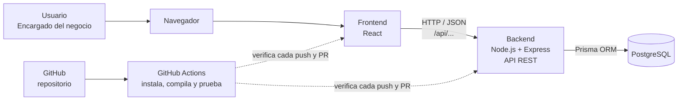

# Arquitectura de ADEL

## 1. Visión general

ADEL usa una arquitectura cliente-servidor de tres capas: una interfaz
web (React) que consume una API REST (Node.js y Express), la cual accede
a una base de datos relacional (PostgreSQL) mediante Prisma ORM. La
integración continua se ejecuta con GitHub Actions.

## 2. Diagrama de bloques



## 3. Responsabilidades por capa

| Capa | Tecnología | Responsabilidad |
|---|---|---|
| Presentación | React | Formularios, pantallas, validaciones básicas y mensajes al usuario |
| Lógica de negocio y API | Node.js + Express | Rutas, validaciones, autenticación, reglas de negocio y cálculos |
| Acceso a datos | Prisma ORM | Modelo de datos, migraciones y consultas |
| Persistencia | PostgreSQL | Almacenamiento de negocios, usuarios, insumos, proveedores y compras |
| Integración continua | GitHub Actions | Instalar dependencias, compilar el frontend y ejecutar las pruebas |

## 4. Estructura de carpetas propuesta

```text
adel/
├── backend/
│   ├── prisma/            # esquema y migraciones
│   ├── src/
│   │   ├── app.js         # aplicación Express (se exporta, no escucha puerto)
│   │   ├── server.js      # arranque del servidor
│   │   ├── routes/        # definición de rutas (/api/...)
│   │   ├── controllers/   # reciben la petición y responden
│   │   ├── services/      # reglas de negocio
│   │   ├── middlewares/   # autenticación, errores
│   │   └── config/        # variables de entorno, conexión
│   ├── tests/             # pruebas unitarias y funcionales (Jest + Supertest)
│   ├── .env.example
│   └── package.json
├── frontend/
│   ├── src/
│   │   ├── components/    # componentes reutilizables
│   │   ├── pages/         # pantallas (registro, login, inventario...)
│   │   ├── services/      # llamadas a la API
│   │   └── App.jsx        # enrutamiento
│   └── package.json
├── docs/                  # arquitectura, modelo ER, actas
├── .github/
│   └── workflows/         # pipeline de GitHub Actions
└── README.md
```

`app.js` se separa de `server.js` para que Supertest pueda probar la
aplicación sin abrir un puerto.

## 5. Convenciones de la API

- Todas las rutas empiezan con el prefijo `/api`.
- Las respuestas son JSON.
- Los errores tienen la forma `{ "mensaje": "descripción del error" }`.
- Códigos HTTP:

| Código | Uso |
|---|---|
| 200 | Consulta o actualización correcta |
| 201 | Recurso creado |
| 400 | Datos inválidos (validación) |
| 401 | Sin sesión o credenciales incorrectas |
| 409 | Conflicto, por ejemplo correo o insumo duplicado |

- Las rutas internas exigen un token de sesión. Cada consulta se filtra
  por el negocio del usuario autenticado (restricción R-01).

## 6. Rutas previstas (entrega 1)

| Método | Ruta | Historia |
|---|---|---|
| GET | /api/health | HT-05 |
| POST | /api/auth/register | HU-01 |
| POST | /api/auth/login | HU-02 |
| POST | /api/insumos | HU-03 |
| GET | /api/insumos | HU-07 |
| POST | /api/proveedores | HU-09 |
| POST | /api/compras | HU-10 |
| GET | /api/insumos/:id/precios | HU-12 |
| GET | /api/insumos/:id/comparacion | HU-13 |

## 7. Decisiones de diseño

- **Una sola aplicación por capa** (monolito modular), por el tiempo del
  proyecto.
- **Relación usuario-negocio 1 a 1** en esta versión (RN-06).
- **Transacciones de Prisma** para registrar usuario y negocio, y compra
  con su inventario.
- **La IA generativa** (Gemini) queda fuera de esta entrega; se conectaría
  desde el backend, nunca desde el frontend.