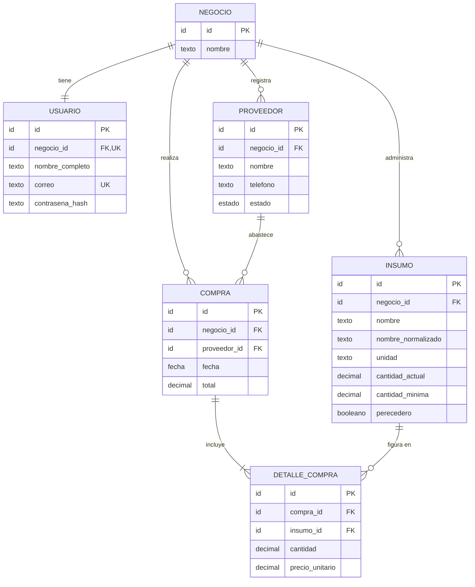

# Modelo entidad–relación de ADEL

**Sprint 1 · HT-03 · T10**

El modelo lógico cubre el registro y el inicio de sesión, la consulta de inventario, la gestión de proveedores, el registro de compras y el historial y la comparación de precios de la primera entrega.

## 1. Diagrama entidad–relación

**PK** significa clave primaria, **FK** significa clave foránea y **UK** indica una restricción de unicidad. Los tipos del diagrama son lógicos. Los tipos físicos y la precisión de los decimales se definen en la T11.

## 2. Entidades y restricciones

| Entidad | Propósito | Restricciones principales |
| --- | --- | --- |
| **Negocio** | Identifica el establecimiento al que pertenecen los datos. | El nombre es obligatorio. Cada negocio registrado se crea junto con su usuario. |
| **Usuario** | Almacena la cuenta con la que se accede al sistema. | El nombre completo y el correo son obligatorios. El correo es único. La contraseña se almacena como hash. `negocio_id` es obligatorio y único. |
| **Insumo** | Registra el producto, su unidad de medida y sus existencias. | La combinación `(negocio_id, nombre_normalizado)` es única. La cantidad actual y la mínima son mayores o iguales a cero. `perecedero` se puede omitir al registrar y toma el valor `false`. |
| **Proveedor** | Registra a quién le compra el negocio. | El nombre es obligatorio. El teléfono se guarda como texto. El estado es `ACTIVO` o `INACTIVO` y comienza como `ACTIVO`. |
| **Compra** | Registra la fecha, el proveedor y el total de una compra. | Pertenece a un negocio y tiene al menos un detalle. El proveedor debe pertenecer al mismo negocio y estar activo cuando se registra la compra. |
| **Detalle de compra** | Guarda cada línea de la compra y su precio histórico. | Referencia una compra y un insumo del mismo negocio. La cantidad y el precio unitario son mayores que cero. La cantidad se expresa en la unidad del insumo. |

## 3. Reglas de negocio y persistencia

### Registro e inicio de sesión (HU-01, HU-02 y RN-06)

El usuario y el negocio se crean en la misma transacción. Si el registro falla, se revierten ambas creaciones. La FK obligatoria en `USUARIO.negocio_id` asegura que cada usuario pertenezca a un negocio. Su unicidad impide asociar una segunda cuenta al mismo negocio. El flujo de registro garantiza que el negocio se cree junto con su cuenta.

### Insumos e inventario (HU-03 y HU-07)

El sistema conserva el nombre que se muestra al usuario y usa `nombre_normalizado` para detectar duplicados. Se propone recortar los espacios al inicio y al final, reducir los espacios interiores consecutivos a uno y convertir a minúsculas. Por ejemplo, ` Arroz ` y `arroz` generan el mismo nombre normalizado dentro del mismo negocio. Dos negocios distintos pueden registrar un insumo con ese mismo nombre.

El inventario muestra el nombre, la unidad y la cantidad actual de los insumos del negocio. Un insumo se resalta cuando `cantidad_actual <= cantidad_minima`.

### Proveedores (HU-09)

Si un proveedor tiene compras registradas, se desactiva y se conserva su historial. Los proveedores inactivos quedan excluidos de las opciones para nuevas compras. Las compras anteriores siguen mostrando el proveedor asociado.

### Aislamiento de datos (R-01)

La API identifica el negocio a partir del usuario autenticado y filtra con ese identificador las consultas de inventario, proveedores, compras y precios. Antes de guardar una compra, verifica que el proveedor y todos los insumos pertenezcan a ese mismo negocio. Estas validaciones se realizan en el backend.

### Compras y actualización de existencias (HU-10 y RN-07)

El total de la compra se calcula sumando `cantidad × precio_unitario` para cada detalle. La cabecera, los detalles y el incremento de la cantidad actual de cada insumo se guardan en una sola transacción. Si falla una validación o una actualización, se revierte toda la operación. Las cantidades y los importes usan tipos decimales.

### Historial y comparación de precios (HU-12 y HU-13)

El precio histórico se guarda en `DETALLE_COMPRA.precio_unitario`. La compra asociada aporta la fecha y el proveedor.

- **Historial.** Se consultan los detalles del insumo y se ordenan cronológicamente por proveedor. La variación se calcula frente a la compra anterior del mismo insumo al mismo proveedor con la fórmula `((precio_actual - precio_anterior) / precio_anterior) × 100`.
- **Comparación.** Se toma el último precio registrado del insumo para cada proveedor y se ordena de menor a mayor.
- **Compras en la misma fecha.** Se propone conservar una marca u orden de registro para resolver empates de forma determinista. El criterio físico se acuerda en la T11.

## 4. Continuación en la T11

Este modelo sirve de base para el esquema de Prisma y la migración inicial de PostgreSQL. La T11 define los tipos físicos, la precisión de los decimales y la implementación de las claves foráneas y restricciones de unicidad.